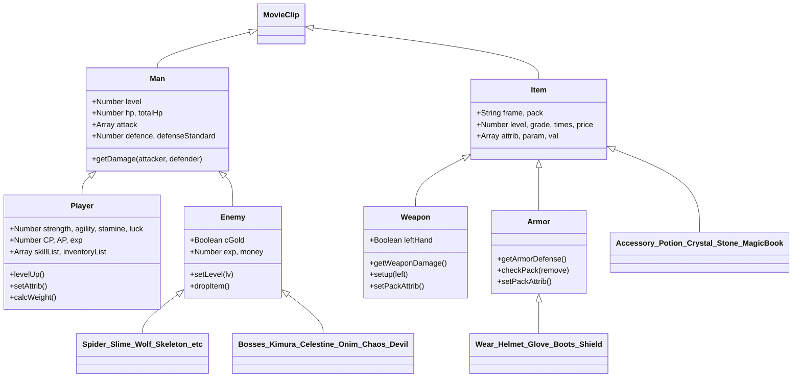

# Arcuz 2: Dungeons — Reverse Engineering & SWF Binary Analysis (`REA_ANALYSIS.md`)

## 1. Executive Summary & Artifact Identity

This document records the reverse engineering analysis of the shipped Flash binary for **Arcuz 2: Dungeons** (`arcuz-2-dungeons.swf`), conducted using the Reverse Engineer Anything (`rea-agents@6.3.0`) methodology and custom Python SWF/AVM bytecode disassemblers.

| Property | Observed Value |
| :--- | :--- |
| **Target Path** | `C:\Flashpoint\Legacy\htdocs\cdn1.gamesting.com\content\games\arcuz-2-dungeons.swf` |
| **Compressed File Size** | `32,428,951` bytes (`0x01eed7b7`) |
| **Uncompressed SWF Size** | `38,013,066` bytes (`0x0244088a`) |
| **Compressed SHA-256** | `fdd6bfb8c178b5673a7b0de4540aac9460494990c91fb1914d147b5310720749` |
| **Uncompressed SHA-256** | `a78d96e09da43b6b102abe3e901248f467c184ef4be3397b6ed004c3fcb053db` |
| **SWF Header Signature** | `CWS` (`0x43 0x57 0x53`, Zlib-compressed SWF) |
| **SWF Version** | `8` (`0x08`) |
| **Stage Dimensions (RECT)** | `0..10000` x `0..9000` twips (`500 x 450` pixels, 16-bit nbits) |
| **Frame Rate / Frame Count** | `35.0` FPS (`0x0023` fixed-8.8) / `147` frames (`0x0093`) |
| **FileAttributes (Tag 69)** | Offset `0x0015` (len `4`), flags `0x00000000` (`UseNetwork=0`, `ActionScript3=0`, `HasMetadata=0`) |
| **Metadata (Tag 77)** | Offset `0x0d11` (len `370`): `<rdf:Description ...>Encrypted by DoSWF Version:4.9.0, Username:nfunnaut@gmail.com.fr, Author:http://www.laaan.cn</rdf:Description>` |
| **Virtual Machine & Code Format** | **AVM1 (ActionScript 2.0)** compiled into `21` `DoAction` (Tag 12) blocks and `259` `DoInitAction` (Tag 59) blocks exported via `ExportAssets` (Tag 56) as `162` `__Packages.<ClassName>` classes and `97` MovieClip symbol initializers |
| **Embedded Localization** | `21` embedded `<LocalisedText>` XML strings in Frame 2 `DoAction` (`offset=0x1e2d4e`), containing **1,195 localized English entries** (`<en>...</en>`) |

> [!IMPORTANT]
> **VM Architecture Finding (Observation vs. Prior Assumption):** Although Flash RPGs from 2011 are often assumed to use ActionScript 3 (`DoABC` Tag 82/72 and `DefineBinaryData` Tag 87), binary inspection proves `arcuz-2-dungeons.swf` is a **SWF Version 8 AVM1 binary** (`FileAttributes` flags `0x00000000`, zero `DoABC` tags, zero `DefineBinaryData` tags). All OOP classes are compiled using the Macromedia/Adobe ActionScript 2.0 `__Packages.<ClassName>` convention inside `DoInitAction` (Tag 59) tags, with `ActionConstantPool` (`0x88`), `ActionDefineFunction2` (`0x8E`), `ActionExtends` (`0x69`), and `ActionImplementsOp` (`0x6C`), protected by **DoSWF v4.9.0** (`http://www.laaan.cn`), which inserts junk constant-pool entries and branch jumps around standard AVM1 stack operations. This report documents both the exact AVM1 bytecode/constant-pool citations and their clean ES6/AS3 architectural mapping for the 3D remake.

---

## 2. SWF Binary Structure & Tag Inventory

### 2.1 Header Layout (`0x0000` – `0x0015`)
- `0x0000..0x0002`: Signature `43 57 53` (`"CWS"`)
- `0x0003`: Version `08` (SWF 8)
- `0x0004..0x0007`: Uncompressed file length `8A 08 44 02` (`38,013,066` bytes little-endian)
- `0x0008..0x0010`: `RECT` bitfield (`80 00 04 E2 00 00 11 94 00` -> `Xmin=0, Xmax=10000` twips [`500` px], `Ymin=0, Ymax=9000` twips [`450` px])
- `0x0011..0x0012`: `FrameRate` `00 23` (`35.0` FPS)
- `0x0013..0x0014`: `FrameCount` `93 00` (`147` frames)
- `0x0015`: Start of SWF Tag stream (`Tag 69 FileAttributes`)

### 2.2 Complete SWF Tag Inventory (`17,452` Tags)

| Tag ID | Tag Name | Count | Role in `arcuz-2-dungeons.swf` |
| :---: | :--- | :---: | :--- |
| `0` | `End` | 1 | End of SWF stream (`offset=0x2440888`) |
| `1` | `ShowFrame` | 147 | Main timeline frames (147 frames) |
| `9` | `SetBackgroundColor` | 1 | Stage background RGB (`0x000000`, `offset=0x0d0c`) |
| `12` | `DoAction` | 21 | Timeline frame scripts; **Frame 2 (`offset=0x1e2d4e`, len `1,219,400`)** holds all XML strings & global tables |
| `14` | `DefineSound` | 127 | Embedded MP3/ADPCM sound effects and BGM tracks |
| `20` | `DefineBitsLossless` | 35 | Lossless bitmap textures (tilesets, UI chrome) |
| `21` | `DefineBitsJPEG2` | 3 | JPEG compressed backgrounds |
| `24` | `Protect` | 1 | SWF import protection tag (`offset=0x0d0e`) |
| `26` | `PlaceObject2` | 10,803 | Display list placement, depth, clip actions |
| `28` | `RemoveObject2` | 3,139 | Display list removal |
| `36` | `DefineBitsLossless2` | 398 | ARGB lossless sprites, icons, map tiles |
| `37` | `DefineEditText` | 162 | Dynamic text fields (damage numbers, HUD, dialogs) |
| `39` | `DefineSprite` | 1,038 | Nested MovieClips (player animations, monsters, skills, UI panels, maps) |
| `43` | `FrameLabel` | 21 | Named timeline anchors (`loading`, `logo`, `menu`, `game`, etc.) |
| `46` | `DefineMorphShape` | 5 | Morph shapes (visual effects) |
| `56` | `ExportAssets` | 269 | Exports **553 linkage symbols** (`162` `__Packages.*` classes + `391` MovieClips/Sounds) |
| `59` | `DoInitAction` | 259 | Class definitions (`162` `__Packages.*`) & component init scripts (`97` sprites) |
| `69` | `FileAttributes` | 1 | SWF 8 capability flags (`0x00000000`, `offset=0x0015`) |
| `77` | `Metadata` | 1 | RDF/XMP DoSWF 4.9.0 signature (`offset=0x0d11`, len `370`) |
| `83` | `DefineShape4` | 1,020 | Vector shapes (sprites, hitboxes, effects, UI) |

### 2.3 Main Timeline `DoAction` (Tag 12) & `FrameLabel` (Tag 43) Map

| DoAction # | Uncompressed Offset | Length (Bytes) | Associated Frame Labels / Purpose |
| :---: | :---: | :---: | :--- |
| `1` | `0xaa09f` (`696479`) | `69` | Preloader & Stage init |
| `2` | `0xaa0ea` (`696554`) | `1,478` | **Master Data & Engine Bootstrap**: 21 XML blocks (`xmlData*`), `Php/Pdef/Patk/Ehp/Eatk`, `getLevelUpExp`, `setQuest`, `skill[0..44]`, `enemyInRandomMap[1..45]`, `Save/Load` |
| `3` | `0x1e2d4e` (`1977678`) | `1,219,400` | Timeline frame script #3 |
| `4` | `0x23ce065` (`37544037`) | `694` | Timeline frame script #4 |
| `5` | `0x23d296b` (`37562731`) | `570` | Timeline frame script #5 |
| `6` | `0x23d5a45` (`37575237`) | `166` | Timeline frame script #6 |
| `7` | `0x23d7b3c` (`37583676`) | `591` | Timeline frame script #7 |
| `8` | `0x23fc032` (`37732402`) | `2,963` | Timeline frame script #8 |
| `9` | `0x23fe4a1` (`37741729`) | `1,182` | Timeline frame script #9 |
| `10` | `0x2400492` (`37749906`) | `211` | Timeline frame script #10 |
| `11` | `0x243b822` (`37992482`) | `1,575` | Timeline frame script #11 |
| `12` | `0x243be5f` (`37994079`) | `168` | Timeline frame script #12 |
| `13` | `0x243bf46` (`37994310`) | `2,830` | Timeline frame script #13 |
| `14` | `0x243cb69` (`37997417`) | `3,091` | Timeline frame script #14 |
| `15` | `0x243d849` (`38000713`) | `117` | Timeline frame script #15 |
| `16` | `0x243e031` (`38002737`) | `116` | Timeline frame script #16 |
| `17` | `0x243e0b6` (`38002870`) | `1` | Timeline frame script #17 |
| `18` | `0x243f42a` (`38007850`) | `117` | Timeline frame script #18 |
| `19` | `0x243f6da` (`38008538`) | `1,591` | Timeline frame script #19 |
| `20` | `0x2440719` (`38012697`) | `224` | Timeline frame script #20 |
| `21` | `0x244087e` (`38013054`) | `2` | Timeline frame script #21 |

---

## 3. ActionScript Class Hierarchy & Architecture (`162` `__Packages.*` Classes)

### 3.1 Subsystem Architecture & Inheritance Graph



### 3.2 Complete Inventory of Exported `__Packages.*` Classes (`162` Classes)

| Sprite ID | Exported Class Name | Tag 59 Offset (Hex) | Tag 59 Offset (Dec) | Bytecode Length (Bytes) |
| :---: | :--- | :---: | :---: | :---: |
| `16085` | `__Packages.SlimeIntro` | `0xe22c0` | `926400` | `1,287` |
| `16086` | `__Packages.XXXX` | `0xe27ef` | `927727` | `2,326` |
| `16087` | `__Packages.Quest` | `0xe312e` | `930094` | `5,532` |
| `16088` | `__Packages.Armor` | `0xe46f3` | `935667` | `27,040` |
| `16089` | `__Packages.Glove` | `0xeb0bc` | `962748` | `6,169` |
| `16090` | `__Packages.BtnInfo` | `0xec900` | `968960` | `1,292` |
| `16091` | `__Packages.Man` | `0xece33` | `970291` | `19,716` |
| `16092` | `__Packages.Player` | `0xf1b61` | `990049` | `158,628` |
| `16093` | `__Packages.XXX` | `0x11872c` | `1148716` | `4,540` |
| `16094` | `__Packages.Potion` | `0x119912` | `1153298` | `11,264` |
| `16095` | `__Packages.Shadows` | `0x11c53d` | `1164605` | `1,500` |
| `16096` | `__Packages.FlyingObject` | `0x11cb49` | `1166153` | `2,403` |
| `16097` | `__Packages.FireBall1` | `0x11d4d9` | `1168601` | `1,878` |
| `16098` | `__Packages.PoisonBall1` | `0x11dc5e` | `1170526` | `2,716` |
| `16099` | `__Packages.SwordPulse` | `0x11e728` | `1173288` | `1,417` |
| `16100` | `__Packages.Hurricane` | `0x11ecde` | `1174750` | `2,308` |
| `16101` | `__Packages.PoisonBall2` | `0x11f611` | `1177105` | `1,433` |
| `16102` | `__Packages.Enemy` | `0x11fbd3` | `1178579` | `22,473` |
| `16103` | `__Packages.MagicBook` | `0x1253c9` | `1201097` | `517` |
| `16104` | `__Packages.DarkKnight` | `0x1255fc` | `1201660` | `13,504` |
| `16105` | `__Packages.PoisonBall` | `0x128aea` | `1215210` | `1,551` |
| `16106` | `__Packages.EnemyMagic` | `0x129127` | `1216807` | `1,870` |
| `16107` | `__Packages.Accessory` | `0x1298a2` | `1218722` | `4,915` |
| `16108` | `__Packages.Bracelet` | `0x12ac01` | `1223681` | `557` |
| `16109` | `__Packages.Wear` | `0x12ae56` | `1224278` | `8,896` |
| `16110` | `__Packages.ShadowPlayer` | `0x12d146` | `1233222` | `40,052` |
| `16111` | `__Packages.TeleporterIII` | `0x136deb` | `1273323` | `2,236` |
| `16112` | `__Packages.SwordPulseII` | `0x1376d7` | `1275607` | `1,383` |
| `16113` | `__Packages.FireBall` | `0x137c6a` | `1277034` | `1,515` |
| `16114` | `__Packages.BigEye` | `0x13827f` | `1278591` | `10,238` |
| `16115` | `__Packages.Tauren` | `0x13aaa7` | `1288871` | `11,766` |
| `16116` | `__Packages.QuestItem` | `0x13d8ca` | `1300682` | `2,387` |
| `16117` | `__Packages.Lizardfolk` | `0x13e24b` | `1303115` | `4,648` |
| `16118` | `__Packages.GoblinWarrior` | `0x13f4a4` | `1307812` | `5,913` |
| `16119` | `__Packages.TeleporterV` | `0x140bec` | `1313772` | `1,857` |
| `16120` | `__Packages.SkeletonKing` | `0x14135d` | `1315677` | `14,330` |
| `16121` | `__Packages.EnemyMagicIII` | `0x144b88` | `1330056` | `3,221` |
| `16122` | `__Packages.Seal` | `0x145845` | `1333317` | `824` |
| `16123` | `__Packages.HellDog` | `0x145ba8` | `1334184` | `14,093` |
| `16124` | `__Packages.EnemyMagicII` | `0x1492e5` | `1348325` | `1,855` |
| `16125` | `__Packages.GoblinArcher` | `0x149a54` | `1350228` | `3,783` |
| `16126` | `__Packages.ArrowEnemy` | `0x14a949` | `1354057` | `1,959` |
| `16127` | `__Packages.LineToCircle` | `0x14b120` | `1356064` | `2,197` |
| `16128` | `__Packages.Wolf` | `0x14b9dd` | `1358301` | `5,327` |
| `16129` | `__Packages.SkeletonWarrior` | `0x14cedf` | `1363679` | `9,431` |
| `16130` | `__Packages.Devil` | `0x14f3df` | `1373151` | `7,376` |
| `16131` | `__Packages.Spider` | `0x1510d9` | `1380569` | `7,755` |
| `16132` | `__Packages.Centaur` | `0x152f4f` | `1388367` | `5,518` |
| `16133` | `__Packages.SecQuest` | `0x154509` | `1393929` | `2,499` |
| `16134` | `__Packages.Crystal` | `0x154ef7` | `1396471` | `1,349` |
| `16135` | `__Packages.WolfWarrior` | `0x15546b` | `1397867` | `6,798` |
| `16136` | `__Packages.SkeletalArcher` | `0x156f2b` | `1404715` | `8,475` |
| `16137` | `__Packages.Necklace` | `0x159072` | `1413234` | `696` |
| `16138` | `__Packages.Belt` | `0x159352` | `1413970` | `554` |
| `16139` | `__Packages.Helmet` | `0x1595a6` | `1414566` | `6,760` |
| `16140` | `__Packages.Balor` | `0x15b037` | `1421367` | `18,810` |
| `16141` | `__Packages.DualHeadGiant` | `0x15f9e2` | `1440226` | `14,854` |
| `16142` | `__Packages.mochi.as2.MochiEventDispatcher` | `0x16342a` | `1455146` | `1,263` |
| `16143` | `__Packages.mochi.as2.MochiCoins` | `0x163951` | `1456465` | `1,659` |
| `16144` | `__Packages.mochi.as2.MochiServices` | `0x164007` | `1458183` | `11,345` |
| `16145` | `__Packages.mochi.as2.MochiEvents` | `0x166c91` | `1469585` | `1,810` |
| `16146` | `__Packages.mochi.as2.MochiSocial` | `0x1673dc` | `1471452` | `2,242` |
| `16147` | `__Packages.GiantSlime` | `0x167ccc` | `1473740` | `6,848` |
| `16148` | `__Packages.TeleporterIV` | `0x1697bc` | `1480636` | `1,707` |
| `16149` | `__Packages.Bat` | `0x169e8e` | `1482382` | `6,927` |
| `16150` | `__Packages.Ring` | `0x16b9c5` | `1489349` | `552` |
| `16151` | `__Packages.SkeletalMage` | `0x16bc1d` | `1489949` | `10,780` |
| `16152` | `__Packages.Boots` | `0x16e662` | `1500770` | `6,215` |
| `16153` | `__Packages.HellHoundPoison` | `0x16fedc` | `1507036` | `1,117` |
| `16154` | `__Packages.mochi.as2.MochiScores` | `0x170372` | `1508210` | `3,698` |
| `16155` | `__Packages.mochi.as2.MochiDigits` | `0x17121d` | `1511965` | `1,110` |
| `16156` | `__Packages.Game` | `0x17169b` | `1513115` | `16,404` |
| `16157` | `__Packages.MapGenerator` | `0x1756df` | `1529567` | `37,003` |
| `16158` | `__Packages.MouseCursor` | `0x17e799` | `1566617` | `1,556` |
| `16159` | `__Packages.Map` | `0x17edd4` | `1568212` | `23,603` |
| `16160` | `__Packages.Slime` | `0x184a30` | `1591856` | `9,708` |
| `16161` | `__Packages.Npc` | `0x187043` | `1601603` | `7,551` |
| `16162` | `__Packages.Npc村长` | `0x188def` | `1609199` | `4,194` |
| `16163` | `__Packages.GoblinMage` | `0x189e7f` | `1613439` | `3,676` |
| `16164` | `__Packages.Npc铁匠` | `0x18ad08` | `1617160` | `8,622` |
| `16165` | `__Packages.Weapon` | `0x18cee0` | `1625824` | `45,934` |
| `16166` | `__Packages.Shield` | `0x198278` | `1671800` | `5,125` |
| `16167` | `__Packages.Npc巫女` | `0x1996aa` | `1676970` | `9,745` |
| `16168` | `__Packages.Teleporter` | `0x19bce9` | `1686761` | `1,468` |
| `16169` | `__Packages.Npc商人` | `0x19c2d2` | `1688274` | `7,422` |
| `16170` | `__Packages.Item` | `0x19dff8` | `1695736` | `24,334` |
| `16171` | `__Packages.ItemInfo` | `0x1a3f32` | `1720114` | `7,103` |
| `16172` | `__Packages.DlgChar` | `0x1a5b1c` | `1727260` | `7,050` |
| `16173` | `__Packages.DlgSkill` | `0x1a76d2` | `1734354` | `15,594` |
| `16174` | `__Packages.SkillInfo` | `0x1ab3e9` | `1749993` | `1,262` |
| `16175` | `__Packages.Npc骑士` | `0x1ab904` | `1751300` | `3,721` |
| `16176` | `__Packages.Npc小女孩` | `0x1ac7bd` | `1755069` | `2,361` |
| `16177` | `__Packages.Npc游侠` | `0x1ad123` | `1757475` | `1,288` |
| `16178` | `__Packages.Obstacle` | `0x1ad657` | `1758807` | `4,392` |
| `16179` | `__Packages.Chest` | `0x1ae7a8` | `1763240` | `17,074` |
| `16180` | `__Packages.Book` | `0x1b2a82` | `1780354` | `3,027` |
| `16181` | `__Packages.SkillMc` | `0x1b3680` | `1783424` | `5,118` |
| `16182` | `__Packages.Coins` | `0x1b4aa7` | `1788583` | `1,481` |
| `16183` | `__Packages.HitCombo` | `0x1b509c` | `1790108` | `2,139` |
| `16184` | `__Packages.Orge` | `0x1b591f` | `1792287` | `6,233` |
| `16185` | `__Packages.FloatingEnemy` | `0x1b71a9` | `1798569` | `437` |
| `16186` | `__Packages.Ghost` | `0x1b7387` | `1799047` | `6,199` |
| `16187` | `__Packages.Teleporter2` | `0x1b8bed` | `1805293` | `2,015` |
| `16188` | `__Packages.DropPotion` | `0x1b93fa` | `1807354` | `7,500` |
| `16189` | `__Packages.PointAndHint` | `0x1bb176` | `1814902` | `1,464` |
| `16190` | `__Packages.ChestMochiCoins` | `0x1bb761` | `1816417` | `7,323` |
| `16191` | `__Packages.Dialog2` | `0x1bd427` | `1823783` | `1,994` |
| `16192` | `__Packages.TeleGate` | `0x1bdc1d` | `1825821` | `7,308` |
| `16193` | `__Packages.TeleGateSelect` | `0x1bf8db` | `1833179` | `1,222` |
| `16194` | `__Packages.Scene` | `0x1bfdca` | `1834442` | `2,784` |
| `16195` | `__Packages.Traps` | `0x1c08d3` | `1837267` | `2,551` |
| `16196` | `__Packages.TrapsGroundGroup1` | `0x1c12ff` | `1839871` | `1,032` |
| `16197` | `__Packages.TrapsGround` | `0x1c1736` | `1840950` | `1,082` |
| `16198` | `__Packages.TrapsWall` | `0x1c1b9d` | `1842077` | `3,837` |
| `16199` | `__Packages.TrapsWall2` | `0x1c2ac8` | `1845960` | `1,387` |
| `16200` | `__Packages.Traps1` | `0x1c305d` | `1847389` | `2,973` |
| `16201` | `__Packages.MagicLever` | `0x1c3c28` | `1850408` | `3,030` |
| `16202` | `__Packages.TrapsWall3` | `0x1c482c` | `1853484` | `954` |
| `16203` | `__Packages.TrapsWall1` | `0x1c4c14` | `1854484` | `915` |
| `16204` | `__Packages.TrapsWall4` | `0x1c4fd5` | `1855445` | `1,068` |
| `16205` | `__Packages.TrapsWall5` | `0x1c542f` | `1856559` | `987` |
| `16206` | `__Packages.TrapsWall6` | `0x1c5838` | `1857592` | `1,151` |
| `16207` | `__Packages.TrapsWall7` | `0x1c5ce5` | `1858789` | `1,020` |
| `16208` | `__Packages.TrapsArrow` | `0x1c610f` | `1859855` | `1,354` |
| `16209` | `__Packages.TrapsGround2` | `0x1c6689` | `1861257` | `2,893` |
| `16210` | `__Packages.TrapsGround3` | `0x1c7206` | `1864198` | `1,130` |
| `16211` | `__Packages.TrapsGroundGroup2` | `0x1c76a5` | `1865381` | `1,032` |
| `16212` | `__Packages.TrapsGroundGroup3` | `0x1c7ae2` | `1866466` | `1,032` |
| `16213` | `__Packages.TrapsGround3Group1` | `0x1c7f20` | `1867552` | `1,080` |
| `16214` | `__Packages.TrapsGround3Group2` | `0x1c838e` | `1868686` | `1,080` |
| `16215` | `__Packages.TrapsGround3Group3` | `0x1c87fc` | `1869820` | `1,114` |
| `16216` | `__Packages.Npc女精灵` | `0x1c8c86` | `1870982` | `3,656` |
| `16217` | `__Packages.Kimura` | `0x1c9af8` | `1874680` | `16,916` |
| `16218` | `__Packages.ArrowKimura` | `0x1cdd3b` | `1891643` | `2,009` |
| `16219` | `__Packages.Npc女精灵石化` | `0x1ce54a` | `1893706` | `1,127` |
| `16220` | `__Packages.Npc地精商人` | `0x1ce9e4` | `1894884` | `4,466` |
| `16221` | `__Packages.Obstacle2` | `0x1cfb83` | `1899395` | `7,850` |
| `16222` | `__Packages.NpcDEADGIRL` | `0x1d1a5c` | `1907292` | `396` |
| `16223` | `__Packages.NpcDEAD` | `0x1d1c13` | `1907731` | `446` |
| `16224` | `__Packages.NpcDARKKNIGHT` | `0x1d1e02` | `1908226` | `1,395` |
| `16225` | `__Packages.NpcDKK` | `0x1d239f` | `1909663` | `1,209` |
| `16226` | `__Packages.BlackHole` | `0x1d2885` | `1910917` | `2,345` |
| `16227` | `__Packages.SelfExpl` | `0x1d31da` | `1913306` | `1,343` |
| `16228` | `__Packages.WeaponDrop` | `0x1d3747` | `1914695` | `2,090` |
| `16229` | `__Packages.FireFairy` | `0x1d3f9e` | `1916830` | `2,349` |
| `16230` | `__Packages.Meteor` | `0x1d48f5` | `1919221` | `1,034` |
| `16231` | `__Packages.DefenceFairy` | `0x1d4d2f` | `1920303` | `2,134` |
| `16232` | `__Packages.Current` | `0x1d55b0` | `1922480` | `1,488` |
| `16233` | `__Packages.KimuraDlg` | `0x1d5bad` | `1924013` | `2,513` |
| `16234` | `__Packages.CelestineAttack` | `0x1d65b1` | `1926577` | `2,391` |
| `16235` | `__Packages.GiftEveryDay` | `0x1d6f38` | `1929016` | `1,907` |
| `16236` | `__Packages.Cloud` | `0x1d76d4` | `1930964` | `819` |
| `16237` | `__Packages.Paulsgrave` | `0x1d7a35` | `1931829` | `1,059` |
| `16238` | `__Packages.SecrectNPC` | `0x1d7e86` | `1932934` | `1,357` |
| `16239` | `__Packages.Dialog` | `0x1d83fd` | `1934333` | `5,515` |
| `16240` | `__Packages.ComposeDialog` | `0x1d99b9` | `1939897` | `22,401` |
| `16241` | `__Packages.Laser1` | `0x1df164` | `1962340` | `1,203` |
| `16242` | `__Packages.HellHoundFire` | `0x1df648` | `1963592` | `1,175` |
| `16243` | `__Packages.HellHoundImpulse` | `0x1dfb13` | `1964819` | `1,831` |
| `16244` | `__Packages.BalorFire` | `0x1e0267` | `1966695` | `1,183` |
| `16245` | `__Packages.Laser2` | `0x1e0730` | `1967920` | `1,294` |
| `16246` | `__Packages.Arena` | `0x1e0c67` | `1969255` | `8,297` |

---

## 4. Hero Stats, Attributes & Leveling Formulas

### 4.1 Base Curve Generator Functions (Frame 2 `DoAction` at `0x1e2d4e`)

At the tail of Frame 2 `DoAction` (`offset=0x1e2d4e`, instructions `14500..14530` and `101050..101198`), the game precomputes global lookup arrays indexed by level `i = 0..125` (active player level cap is `120`):

1. **`nextHp(hp)`** (`inst 14500`):
   ```javascript
   function nextHp(hp) {
       return hp + 40 + Math.floor(hp * 0.01);
   }
   ```
2. **`returnHP(level)`** (`inst 14508`):
   ```javascript
   function returnHP(level) {
       var reg2 = 456;
       for (var reg1 = 0; reg1 < level; reg1++) {
           reg2 = nextHp(reg2);
       }
       return reg2;
   }
   ```
3. **Global Base Stat Arrays (`Php`, `Pdef`, `Patk`, `Ehp`, `Eatk`)** (`inst 101050..101198`):
   - **Player Base HP (`Php[i]`)**: `Math.floor(returnHP(i))`
   - **Standard Defense (`Pdef[i]`)**: `Math.floor(returnHP(i) * 0.25)`
   - **Standard Attack (`Patk[i]`)**: `Math.floor(returnHP(i) * 0.30)`
   - **Enemy Base HP (`Ehp[i]`)**: `Math.floor(i * 110 + returnHP(i) * 2.2)`
   - **Enemy Base Attack (`Eatk[i]`)**: `Math.floor(returnHP(i) * 0.12 - (120 - i) * 0.1)`

4. **Experience Curves (`getEnemyExp` at `inst 10438`, `getLevelUpExp` at `inst 10416`)**:
   ```javascript
   function getEnemyExp(level) {
       var val = 6;
       for (var i = 0; i < level; i++) {
           val += 4 + Math.floor(i / 10);
       }
       return val; // Stored in enemyExp[0..120]
   }
   function getLevelUpExp(level) {
       var eff = (level > 60) ? (level - 50) : level;
       return (8 + Math.floor(eff * 4.5)) * enemyExp[level]; // Stored in expArr[1..121]
   }
   ```

### 4.2 Precomputed Level Scaling Table (Sampled Levels `1` to `120`)

| Level (`i`) | `Php[i]` (Base HP) | `Patk[i]` (Std ATK) | `Pdef[i]` (Std DEF) | `Ehp[i]` (Enemy Base HP) | `Eatk[i]` (Enemy Base ATK) | `enemyExp[i]` | `expArr[i]` (EXP to Next Lv) |
| :---: | :---: | :---: | :---: | :---: | :---: | :---: | :---: |
| `1` | `500` | `150` | `125` | `1,210` | `48` | `10` | `120` |
| `2` | `545` | `163` | `136` | `1,419` | `53` | `14` | `238` |
| `5` | `681` | `204` | `170` | `2,048` | `70` | `26` | `780` |
| `10` | `917` | `275` | `229` | `3,117` | `99` | `46` | `2,438` |
| `15` | `1,166` | `349` | `291` | `4,215` | `129` | `71` | `5,325` |
| `20` | `1,427` | `428` | `356` | `5,339` | `161` | `96` | `9,408` |
| `25` | `1,701` | `510` | `425` | `6,492` | `194` | `126` | `15,120` |
| `30` | `1,990` | `597` | `497` | `7,678` | `229` | `156` | `22,308` |
| `40` | `2,611` | `783` | `652` | `10,144` | `305` | `226` | `42,488` |
| `50` | `3,298` | `989` | `824` | `12,755` | `388` | `306` | `71,298` |
| `60` | `4,055` | `1,216` | `1,013` | `15,521` | `480` | `396` | `110,088` |
| `70` | `4,893` | `1,467` | `1,223` | `18,464` | `582` | `496` | `48,608` |
| `80` | `5,818` | `1,745` | `1,454` | `21,599` | `694` | `606` | `86,658` |
| `90` | `6,843` | `2,052` | `1,710` | `24,954` | `818` | `726` | `136,488` |
| `100` | `7,972` | `2,391` | `1,993` | `28,538` | `954` | `856` | `199,448` |
| `110` | `9,219` | `2,765` | `2,304` | `32,381` | `1,105` | `996` | `276,888` |
| `120` | `10,597` | `3,179` | `2,649` | `36,513` | `1,271` | `1,146` | `370,158` |

### 4.3 Primary Attributes & Level-Up Allocation (`__Packages.Player`, `offset=0x0f1b61`)

- **Level-Up Gains (`Player.levelUp`, `inst 417..430`)**:
  - `+5 CP` (Character Attribute Points) per level (`player.CP += 5`). Passive Skill #7 (`skill[6]`, **Extra CP**) grants an additional `[0, 5, 10, 15, 20, 25, 30, 35, 40, 45, 50]` total CP.
  - `+1 AP` (Action/Skill Point) per level (`player.AP += 1`).
- **Primary Attribute Scaling (`Player.setAttrib` / `strengthUp` / `agilityUp` / `stamineUp` / `luckUp`)**:
  - **Strength (`strength`)**:
    - `attackMin0 = Math.floor(Patk[level] * 0.2) + strength * 1`
    - `attackMax0 = Math.floor(Patk[level] * 0.2) + strength * 2`
    - `encumbrance0 = 80 + strength * 5 + skill[3].val[skillList[3]]` (where `skill[3]` is **Weight Capacity** adding `+100..+1000` max weight)
  - **Agility (`agility`)**:
    - `defenseStandard = Math.floor(Pdef[level])`
    - `defence0 = Math.floor(defenseStandard * 0.2 + agility * 1)`
    - `blockRate0 = Math.floor(agility / 15)` (%)
  - **Constitution (`stamine`)**:
    - `totalHp0 = Math.floor(Php[level]) + stamine * 10`
    - `totalSp0 = Math.floor(totalHp0 / 3.1) + stamine * 5`
  - **Luck (`luck`)**:
    - `criticalHit0 = Math.floor(luck / 10)` (%)
    - `dropRate0 = luck` (%)

---

## 5. Combat Mechanics & Damage Pipeline (`__Packages.Man`, `offset=0x0ece33`)

In `__Packages.Man.getDamage` (`offset=0x0ece33`, instructions `3723..3839`), every hit between an attacker (`reg1`) and defender (`reg5`) is resolved as follows:

1. **Base Attack Roll**:
   - If max-attack buff (`buffArr[6]`, **Overload**) is active: `raw = attacker.attack[1]`.
   - Otherwise: `raw = random(attacker.attack[1] - attacker.attack[0]) + attacker.attack[0]`.
   - Add active skill flat bonus (`skillAttack`) and multiply by `attacker.attackM` (buff/debuff multiplier, default `1.0`) and active skill `dmg`% multiplier (`skill[id].dmg[lv] / 100`).
2. **Defense Mitigation**:
   - `dmg = raw * attacker.defenseStandard / (defender.defence * defender.defenceM)`
   - Note: For enemies, `attacker.defenseStandard` equals `Pdef[enemy.level]`, meaning an unarmored player (`defence = 0.2 * Pdef[lv]`) takes significantly amplified damage until equipping armor across the 5 armor slots (`wear`, `helmet`, `glove`, `boots`, `shield`).
3. **Level Difference Multiplier (`diff = attacker.level - defender.level`)**:
   - If `diff > 0`: `dmg = dmg * (1 + diff * 0.3)` (`+30%` damage per level advantage)
   - If `diff < 0`: `dmg = dmg * (1 + diff * 0.2)` (`-20%` damage per level disadvantage)
4. **Critical Hit & Dual-Wield Scaling**:
   - **Critical Hit**: Rolled against `criticalHit = criticalHit0 + criticalHit1 + buffCrit`. Deals **`2.0x`** damage (or `2.0x + skill[37].val` with **Fatal Blow** passive).
   - **Dual Wield (`Weapon.setup`, `inst 1801..2689`)**: Unlocked when `skillList[41] >= 1` (**Dual Wield Proficiency**, `skill[41]`). Combines main-hand (`inventoryList[10]`) and off-hand (`inventoryList[15]`) weapon damage multiplied by `skill[41].val[lv] / 100` (`30%` at Lv.1 up to `78%` at Lv.25 of combined total).
5. **Minimum Clamp**: `dmg = Math.max(1, Math.round(dmg))`.

---

## 6. Skills & Skill Trees (`45` Skills)

Extracted from Frame 2 `DoAction` (`offset=0x1e2d4e`, instructions `100476..100895`), `__Packages.DlgSkill` (`offset=0x0e6b6b`, instructions `302..3810`), and `xmlDataSkill` / `xmlDataSkill_1` (`技能文字1..45`). Cooldown frames (`dura`) are converted to seconds at `35.0` FPS.

| ID | Array Idx | Skill Name | Category | Weapon | Max Lv | Cooldown (s) | SP Cost | Damage % | Duration (s) | Effect / Values by Level | Prerequisites |
| :---: | :---: | :--- | :--- | :---: | :---: | :--- | :--- | :--- | :--- | :--- | :--- |
| `1` | `skill[0]` | **Falchion Proficiency (Passive)** | `weapon_mastery_passive` | `blade` | `1` | - | - | - | - | - | `-` |
| `2` | `skill[1]` | **Axe Proficiency (Passive)** | `weapon_mastery_passive` | `axe` | `1` | - | - | - | - | - | `-` |
| `3` | `skill[2]` | **Sword Proficiency (Passive)** | `weapon_mastery_passive` | `sword` | `1` | - | - | - | - | - | `{"heroLevelPerRank": 2, "baseHeroLevel": 2}` |
| `4` | `skill[3]` | **Heroic Stamina (Passive)** | `passive_talent` | `any` | `1` | - | - | - | - | - | `{"heroLevel": 5}` |
| `5` | `skill[4]` | **Inner Strength (Passive)** | `passive_talent` | `any` | `1` | - | - | - | - | - | `{"heroLevel": 10}` |
| `6` | `skill[5]` | **Battle Frenzy (Passive)** | `passive_talent` | `any` | `1` | - | - | - | - | - | `{"heroLevel": 15, "heroLevelPerRank": 3}` |
| `7` | `skill[6]` | **Enlightenment (Passive)** | `passive_talent` | `any` | `1` | - | - | - | - | - | `{"heroLevel": 20, "heroLevelPerRank": 2}` |
| `8` | `skill[7]` | **Falchion Final Blow (Passive)** | `weapon_mastery_passive` | `blade` | `1` | - | - | - | - | - | `{"reqSkillId": 1, "reqSkillLevel": 1}` |
| `9` | `skill[8]` | **Axe Final Blow (Passive)** | `weapon_mastery_passive` | `axe` | `1` | - | - | - | - | - | `{"reqSkillId": 2, "reqSkillLevel": 1}` |
| `10` | `skill[9]` | **Sword Final Blow (Passive)** | `weapon_mastery_passive` | `sword` | `1` | - | - | - | - | - | `{"reqSkillId": 3, "reqSkillLevel": 1}` |
| `11` | `skill[10]` | **Falchion Flurry (Active)** | `active_attack` | `blade` | `1` | - | - | - | - | - | `{"reqSkillId": 8, "reqSkillLevelsByRank": [3, 6, 9]}` |
| `12` | `skill[11]` | **Axe Reaper (Active)** | `active_attack` | `axe` | `1` | - | - | - | - | - | `{"reqSkillId": 9, "reqSkillLevelsByRank": [3, 6, 9]}` |
| `13` | `skill[12]` | **Sword Lunge (Active)** | `active_attack` | `sword` | `1` | - | - | - | - | - | `{"reqSkillId": 10, "reqSkillLevelsByRank": [3, 6, 9]}` |
| `14` | `skill[13]` | **Hurricane I (Active)** | `active_attack` | `any` | `1` | - | - | - | - | - | `{"heroLevel": 5, "heroLevelPerRank": 3}` |
| `15` | `skill[14]` | **Hurricane II (Active)** | `active_attack` | `any` | `1` | - | - | - | - | - | `{"heroLevel": 15, "heroLevelPerRank": 3, "reqSkillId": 14, "reqSkillLevel": 3}` |
| `16` | `skill[15]` | **Blade Storm (Active)** | `active_attack` | `any` | `1` | - | - | - | - | - | `{"heroLevel": 25, "heroLevelPerRank": 3, "reqSkillId": 15, "reqSkillLevel": 3}` |
| `17` | `skill[16]` | **Force Wave (Active)** | `active_attack` | `any` | `1` | - | - | - | - | - | `{"heroLevel": 5, "heroLevelPerRank": 4}` |
| `18` | `skill[17]` | **Elemental Wave (Active)** | `active_attack` | `any` | `1` | - | - | - | - | - | `{"heroLevel": 15, "heroLevelPerRank": 3, "reqSkillId": 17, "reqSkillLevel": 3}` |
| `19` | `skill[18]` | **Force Globe (Active)** | `active_attack` | `any` | `1` | - | - | - | - | - | `{"heroLevel": 25, "heroLevelPerRank": 3, "reqSkillId": 18, "reqSkillLevel": 3}` |
| `20` | `skill[19]` | **Berserk (Active)** | `active_attack` | `any` | `1` | - | - | - | - | - | `{"heroLevel": 5, "heroLevelPerRank": 5}` |
| `21` | `skill[20]` | **Sprint (Active)** | `active_attack` | `any` | `1` | - | - | - | - | - | `{"heroLevel": 10, "heroLevelPerRank": 5}` |
| `22` | `skill[21]` | **Life Force (Active)** | `active_attack` | `any` | `1` | - | - | - | - | - | `{"heroLevel": 30, "heroLevelPerRank": 10}` |
| `23` | `skill[22]` | **Dash (Active)** | `active_attack` | `dual` | `1` | - | - | - | - | - | `{"reqSkillId": 43, "reqSkillLevel": 1}` |
| `24` | `skill[23]` | **Backstab I (Active)** | `active_attack` | `dual` | `1` | - | - | - | - | - | `{"reqSkillId": 23, "reqSkillLevel": 1}` |
| `25` | `skill[24]` | **Backstab II (Active)** | `active_attack` | `dual` | `1` | - | - | - | - | - | `{"reqSkillId": 24, "reqSkillLevel": 3}` |
| `26` | `skill[25]` | **Backstab III (Active)** | `active_attack` | `dual` | `1` | - | - | - | - | - | `{"reqSkillId": 25, "reqSkillLevel": 3}` |
| `27` | `skill[26]` | **Guardian (Active)** | `active_attack` | `any` | `1` | - | - | - | - | - | `{"heroLevel": 15, "heroLevelPerRank": 3}` |
| `28` | `skill[27]` | **Divine Blessing (Active)** | `active_attack` | `any` | `1` | - | - | - | - | - | `{"heroLevel": 10, "heroLevelPerRank": 5}` |
| `29` | `skill[28]` | **Fire Elemental (Active)** | `active_attack` | `any` | `1` | - | - | - | - | - | `{"heroLevel": 15, "heroLevelPerRank": 3}` |
| `30` | `skill[29]` | **Deflection (Active)** | `active_attack` | `shield` | `1` | - | - | - | - | - | `{"heroLevel": 5, "heroLevelPerRank": 2, "reqSkillId": 44, "reqSkillLevel": 1}` |
| `31` | `skill[30]` | **Shield Bash I (Active)** | `active_attack` | `shield` | `1` | - | - | - | - | - | `{"heroLevel": 15, "heroLevelPerRank": 2, "reqSkillId": 30, "reqSkillLevel": 1}` |
| `32` | `skill[31]` | **Shield Bash II (Active)** | `active_attack` | `shield` | `1` | - | - | - | - | - | `{"heroLevel": 25, "heroLevelPerRank": 2, "reqSkillId": 31, "reqSkillLevel": 3}` |
| `33` | `skill[32]` | **Set Skill** | `active_attack` | `any` | `1` | - | - | - | - | - | `-` |
| `34` | `skill[33]` | **Summon Storm (Active)** | `active_attack` | `any` | `1` | - | - | - | - | - | `{"heroLevel": 45, "heroLevelPerRank": 3, "reqSkillId": 16, "reqSkillLevel": 3}` |
| `35` | `skill[34]` | **Meteor Storm (Active)** | `active_attack` | `any` | `1` | - | - | - | - | - | `{"heroLevel": 45, "heroLevelPerRank": 3, "reqSkillId": 19, "reqSkillLevel": 3}` |
| `36` | `skill[35]` | **Charge Slash I (Passive)** | `passive_talent` | `any` | `1` | - | - | - | - | - | `{"heroLevel": 10}` |
| `37` | `skill[36]` | **Charge Slash II (Passive)** | `passive_talent` | `any` | `1` | - | - | - | - | - | `{"heroLevel": 15}` |
| `38` | `skill[37]` | **Assassin (Passive)** | `passive_talent` | `any` | `1` | - | - | - | - | - | `{"heroLevel": 5}` |
| `39` | `skill[38]` | **Last Stand (Passive)** | `passive_talent` | `any` | `1` | - | - | - | - | - | `{"heroLevel": 5}` |
| `40` | `skill[39]` | **Tiger Jump (Passive)** | `passive_talent` | `any` | `1` | - | - | - | - | - | `{"heroLevel": 5}` |
| `41` | `skill[40]` | **Protection from Evil (Passive)** | `passive_talent` | `any` | `1` | - | - | - | - | - | `{"heroLevel": 15, "heroLevelPerRank": 3}` |
| `42` | `skill[41]` | **Dual Wield (Passive)** | `weapon_mastery_passive` | `dual` | `1` | - | - | - | - | - | `{"heroLevel": 5, "heroLevelPerRank": 2}` |
| `43` | `skill[42]` | **Cross Slash (Passive)** | `weapon_mastery_passive` | `dual` | `1` | - | - | - | - | - | `{"reqSkillId": 42, "reqSkillLevel": 1}` |
| `44` | `skill[43]` | **Master of Defense(Passive)** | `passive_talent` | `shield` | `1` | - | - | - | - | - | `{"heroLevel": 5, "heroLevelPerRank": 2}` |
| `45` | `skill[44]` | **Damage Reflection (Passive)** | `passive_talent` | `shield` | `1` | - | - | - | - | - | `{"heroLevel": 45, "heroLevelPerRank": 2, "reqSkillId": 32, "reqSkillLevel": 3}` |

---

## 7. Items, Equipment, Sets & Composing System

### 7.1 Weapon Subtypes & Damage Formula (`__Packages.Weapon`, `offset=0x18cee0`, `inst 548..739`)

```javascript
minBase = Math.floor(Patk[levelRequire] * dmgMultMin * 0.8);
maxBase = Math.floor(minBase * dmgMultMax);
minFinal = minBase + Math.ceil(minBase * level * 0.04) + Math.ceil(minBase * (grade - 1) * 0.1);
maxFinal = maxBase + Math.ceil(maxBase * level * 0.04) + Math.ceil(maxBase * (grade - 1) * 0.1);
```

| Subtype | Code Prefix | Tiers | `dmgMultMin` | `dmgMultMax` | Base Weight | Weight Step (/5 Lv) |
| :--- | :---: | :---: | :---: | :---: | :---: | :---: |
| **Sword** | `s1..s14` | `14` | `0.9` | `1.1` | `10` | `+3` |
| **Blade** | `b1..b13` | `13` | `0.8` | `1.03` | `6` | `+2` |
| **Axe** | `a1..a13` | `13` | `1.0` | `1.35` | `15` | `+5` |

### 7.2 Complete Weapons Table (`40` Weapons)

| ID | Subtype | Name | Req Lv | Base Min ATK | Base Max ATK | Weight | Base Price | Lore / Description |
| :---: | :---: | :--- | :---: | :---: | :---: | :---: | :---: | :--- |
| `s1` | `sword` | **Sword Tier 1** | `1` | `108` | `118` | `10` | `63` |  |
| `s2` | `sword` | **Sword Tier 2** | `5` | `146` | `160` | `10` | `297` |  |
| `s3` | `sword` | **Sword Tier 3** | `10` | `198` | `217` | `13` | `612` |  |
| `s4` | `sword` | **Sword Tier 4** | `15` | `251` | `276` | `16` | `963` |  |
| `s5` | `sword` | **Sword Tier 5** | `20` | `308` | `338` | `19` | `1350` |  |
| `s6` | `sword` | **Sword Tier 6** | `25` | `367` | `403` | `22` | `1773` |  |
| `s7` | `sword` | **Sword Tier 7** | `30` | `429` | `471` | `25` | `2232` |  |
| `s8` | `sword` | **Sword Tier 8** | `35` | `494` | `543` | `28` | `2727` |  |
| `s9` | `sword` | **Sword Tier 9** | `40` | `563` | `619` | `31` | `3258` |  |
| `s10` | `sword` | **Sword Tier 10** | `45` | `635` | `698` | `34` | `3825` |  |
| `s11` | `sword` | **Sword Tier 11** | `50` | `712` | `783` | `37` | `4428` |  |
| `s12` | `sword` | **Sword Tier 12** | `55` | `792` | `871` | `40` | `5067` |  |
| `s13` | `sword` | **Sword Tier 13** | `60` | `875` | `962` | `43` | `5742` |  |
| `s14` | `sword` | **Sword Tier 14** | `65` | `963` | `1059` | `46` | `6453` |  |
| `b1` | `blade` | **Blade Tier 1** | `1` | `96` | `98` | `6` | `63` |  |
| `b2` | `blade` | **Blade Tier 2** | `5` | `130` | `133` | `6` | `297` |  |
| `b3` | `blade` | **Blade Tier 3** | `10` | `176` | `181` | `8` | `612` |  |
| `b4` | `blade` | **Blade Tier 4** | `15` | `223` | `229` | `10` | `963` |  |
| `b5` | `blade` | **Blade Tier 5** | `20` | `273` | `281` | `12` | `1350` |  |
| `b6` | `blade` | **Blade Tier 6** | `25` | `326` | `335` | `14` | `1773` |  |
| `b7` | `blade` | **Blade Tier 7** | `30` | `382` | `393` | `16` | `2232` |  |
| `b8` | `blade` | **Blade Tier 8** | `35` | `439` | `452` | `18` | `2727` |  |
| `b9` | `blade` | **Blade Tier 9** | `40` | `501` | `516` | `20` | `3258` |  |
| `b10` | `blade` | **Blade Tier 10** | `45` | `565` | `581` | `22` | `3825` |  |
| `b11` | `blade` | **Blade Tier 11** | `50` | `632` | `650` | `24` | `4428` |  |
| `b12` | `blade` | **Blade Tier 12** | `55` | `704` | `725` | `26` | `5067` |  |
| `b13` | `blade` | **Blade Tier 13** | `60` | `778` | `801` | `28` | `5742` |  |
| `a1` | `axe` | **Axe Tier 1** | `1` | `120` | `162` | `15` | `63` |  |
| `a2` | `axe` | **Axe Tier 2** | `5` | `163` | `220` | `15` | `297` |  |
| `a3` | `axe` | **Axe Tier 3** | `10` | `220` | `297` | `20` | `612` |  |
| `a4` | `axe` | **Axe Tier 4** | `15` | `279` | `376` | `25` | `963` |  |
| `a5` | `axe` | **Axe Tier 5** | `20` | `342` | `461` | `30` | `1350` |  |
| `a6` | `axe` | **Axe Tier 6** | `25` | `408` | `550` | `35` | `1773` |  |
| `a7` | `axe` | **Axe Tier 7** | `30` | `477` | `643` | `40` | `2232` |  |
| `a8` | `axe` | **Axe Tier 8** | `35` | `549` | `741` | `45` | `2727` |  |
| `a9` | `axe` | **Axe Tier 9** | `40` | `626` | `845` | `50` | `3258` |  |
| `a10` | `axe` | **Axe Tier 10** | `45` | `706` | `953` | `55` | `3825` |  |
| `a11` | `axe` | **Axe Tier 11** | `50` | `791` | `1067` | `60` | `4428` |  |
| `a12` | `axe` | **Axe Tier 12** | `55` | `880` | `1188` | `65` | `5067` |  |
| `a13` | `axe` | **Axe Tier 13** | `60` | `972` | `1312` | `70` | `5742` |  |

### 7.3 Complete Armor & Shields Table (`65` Pieces Across 5 Slots)

| ID | Slot | Name | Req Lv | Base DEF | Weight | Block Rate | Base Price | Description |
| :---: | :---: | :--- | :---: | :---: | :---: | :---: | :---: | :--- |
| `w1` | `wear` | **Wear Tier 1** | `1` | `43` | `12` | - | `50` |  |
| `w2` | `wear` | **Wear Tier 2** | `5` | `59` | `12` | - | `235` |  |
| `w3` | `wear` | **Wear Tier 3** | `10` | `80` | `16` | - | `485` |  |
| `w4` | `wear` | **Wear Tier 4** | `15` | `101` | `20` | - | `765` |  |
| `w5` | `wear` | **Wear Tier 5** | `20` | `124` | `24` | - | `1075` |  |
| `w6` | `wear` | **Wear Tier 6** | `25` | `148` | `28` | - | `1415` |  |
| `w7` | `wear` | **Wear Tier 7** | `30` | `173` | `32` | - | `1785` |  |
| `w8` | `wear` | **Wear Tier 8** | `35` | `200` | `36` | - | `2185` |  |
| `w9` | `wear` | **Wear Tier 9** | `40` | `228` | `40` | - | `2615` |  |
| `w10` | `wear` | **Wear Tier 10** | `45` | `257` | `44` | - | `3075` |  |
| `w11` | `wear` | **Wear Tier 11** | `50` | `288` | `48` | - | `3565` |  |
| `w12` | `wear` | **Wear Tier 12** | `55` | `320` | `52` | - | `4085` |  |
| `w13` | `wear` | **Wear Tier 13** | `60` | `354` | `56` | - | `4635` |  |
| `hel1` | `helmet` | **Helmet Tier 1** | `1` | `25` | `6` | - | `50` |  |
| `hel2` | `helmet` | **Helmet Tier 2** | `5` | `34` | `6` | - | `235` |  |
| `hel3` | `helmet` | **Helmet Tier 3** | `10` | `45` | `8` | - | `485` |  |
| `hel4` | `helmet` | **Helmet Tier 4** | `15` | `58` | `10` | - | `765` |  |
| `hel5` | `helmet` | **Helmet Tier 5** | `20` | `71` | `12` | - | `1075` |  |
| `hel6` | `helmet` | **Helmet Tier 6** | `25` | `85` | `14` | - | `1415` |  |
| `hel7` | `helmet` | **Helmet Tier 7** | `30` | `99` | `16` | - | `1785` |  |
| `hel8` | `helmet` | **Helmet Tier 8** | `35` | `114` | `18` | - | `2185` |  |
| `hel9` | `helmet` | **Helmet Tier 9** | `40` | `130` | `20` | - | `2615` |  |
| `hel10` | `helmet` | **Helmet Tier 10** | `45` | `147` | `22` | - | `3075` |  |
| `hel11` | `helmet` | **Helmet Tier 11** | `50` | `164` | `24` | - | `3565` |  |
| `hel12` | `helmet` | **Helmet Tier 12** | `55` | `183` | `26` | - | `4085` |  |
| `hel13` | `helmet` | **Helmet Tier 13** | `60` | `202` | `28` | - | `4635` |  |
| `g1` | `glove` | **Glove Tier 1** | `1` | `18` | `4` | - | `50` |  |
| `g2` | `glove` | **Glove Tier 2** | `5` | `25` | `4` | - | `235` |  |
| `g3` | `glove` | **Glove Tier 3** | `10` | `34` | `5` | - | `485` |  |
| `g4` | `glove` | **Glove Tier 4** | `15` | `43` | `6` | - | `765` |  |
| `g5` | `glove` | **Glove Tier 5** | `20` | `53` | `7` | - | `1075` |  |
| `g6` | `glove` | **Glove Tier 6** | `25` | `63` | `8` | - | `1415` |  |
| `g7` | `glove` | **Glove Tier 7** | `30` | `74` | `9` | - | `1785` |  |
| `g8` | `glove` | **Glove Tier 8** | `35` | `85` | `10` | - | `2185` |  |
| `g9` | `glove` | **Glove Tier 9** | `40` | `97` | `11` | - | `2615` |  |
| `g10` | `glove` | **Glove Tier 10** | `45` | `110` | `12` | - | `3075` |  |
| `g11` | `glove` | **Glove Tier 11** | `50` | `123` | `13` | - | `3565` |  |
| `g12` | `glove` | **Glove Tier 12** | `55` | `137` | `14` | - | `4085` |  |
| `g13` | `glove` | **Glove Tier 13** | `60` | `151` | `15` | - | `4635` |  |
| `bt1` | `boots` | **Boots Tier 1** | `1` | `18` | `5` | - | `50` |  |
| `bt2` | `boots` | **Boots Tier 2** | `5` | `25` | `5` | - | `235` |  |
| `bt3` | `boots` | **Boots Tier 3** | `10` | `34` | `7` | - | `485` |  |
| `bt4` | `boots` | **Boots Tier 4** | `15` | `43` | `9` | - | `765` |  |
| `bt5` | `boots` | **Boots Tier 5** | `20` | `53` | `11` | - | `1075` |  |
| `bt6` | `boots` | **Boots Tier 6** | `25` | `63` | `13` | - | `1415` |  |
| `bt7` | `boots` | **Boots Tier 7** | `30` | `74` | `15` | - | `1785` |  |
| `bt8` | `boots` | **Boots Tier 8** | `35` | `85` | `17` | - | `2185` |  |
| `bt9` | `boots` | **Boots Tier 9** | `40` | `97` | `19` | - | `2615` |  |
| `bt10` | `boots` | **Boots Tier 10** | `45` | `110` | `21` | - | `3075` |  |
| `bt11` | `boots` | **Boots Tier 11** | `50` | `123` | `23` | - | `3565` |  |
| `bt12` | `boots` | **Boots Tier 12** | `55` | `137` | `25` | - | `4085` |  |
| `bt13` | `boots` | **Boots Tier 13** | `60` | `151` | `27` | - | `4635` |  |
| `shield1` | `shield` | **Shield Tier 1** | `1` | `31` | `10` | 10% | `50` |  |
| `shield2` | `shield` | **Shield Tier 2** | `5` | `42` | `10` | 12% | `235` |  |
| `shield3` | `shield` | **Shield Tier 3** | `10` | `57` | `13` | 14% | `485` |  |
| `shield4` | `shield` | **Shield Tier 4** | `15` | `72` | `16` | 16% | `765` |  |
| `shield5` | `shield` | **Shield Tier 5** | `20` | `89` | `19` | 18% | `1075` |  |
| `shield6` | `shield` | **Shield Tier 6** | `25` | `106` | `22` | 20% | `1415` |  |
| `shield7` | `shield` | **Shield Tier 7** | `30` | `124` | `25` | 22% | `1785` |  |
| `shield8` | `shield` | **Shield Tier 8** | `35` | `143` | `28` | 24% | `2185` |  |
| `shield9` | `shield` | **Shield Tier 9** | `40` | `163` | `31` | 26% | `2615` |  |
| `shield10` | `shield` | **Shield Tier 10** | `45` | `184` | `34` | 28% | `3075` |  |
| `shield11` | `shield` | **Shield Tier 11** | `50` | `206` | `37` | 30% | `3565` |  |
| `shield12` | `shield` | **Shield Tier 12** | `55` | `229` | `40` | 32% | `4085` |  |
| `shield13` | `shield` | **Shield Tier 13** | `60` | `253` | `43` | 34% | `4635` |  |

### 7.4 Equipment Sets (`pack` `a` – `p`, `__Packages.Armor.checkPack` `inst 1797..6505`)

| Set ID | XML Key | Set Name | Set Pieces | Exact Full-Set Bonus (`Armor.checkPack`) |
| :---: | :---: | :--- | :--- | :--- |
| `a` | `套装a` | **Many ambitious warriors have searched the world for the fabled Blazing Set.  Once united, the fire-enchanted helmet, armor, gloves, boots, and weapon give the user an affinity for fire, and the ability to summon flames to burn enemies.  The wearer of the Blazing Set deals more damage in combat, and has an increased chance to score critical hits. (Extra attrib.: Lv2 critical hit, Lv4 fire attribute, Lv3 attack bonus. Set skill: Fissure I)** |  | `{"pieces": ["weapon", "wear", "helmet", "glove", "boots"], "skillBonusLevel": 3, "criticalHitPct": 8, "element": "fire", "elementLevel": 4, "atkBonus": 75}` |
| `b` | `套装b` | **The Swamp Witch's failed golem experiments gave rise to items which seem strangely alive.  Those who wear the envenomed helmet, armor, gloves, boots, and weapon can summon a Plague to weaken their enemies.  The wearer can also dissolve worthless materials left behind by fallen foes to reveal magical treasures more often, recover from injuries more rapidly, and has affinity for poison.** |  | `{"pieces": ["weapon", "wear", "helmet", "glove", "boots"], "skillBonusLevel": 9, "dropRatePct": 15, "element": "poison", "elementLevel": 4, "hpRegain": 8}` |
| `c` | `套装c` | **Set C** |  | `{"pieces": ["wear", "helmet", "glove", "boots"], "skillBonusLevel": -1, "maxHpBonus": 600, "hpRegain": 30}` |
| `d` | `套装d` | **A secret society of vampires constructed life-draining armor for their battle thralls.  Those who wear the vampires' helmet, armor, gloves, and boots find that they heal quickly, and absorb life energies from slain foes. (Extra attrib: Lv4 HP recovery, Lv4 HP gained after an enemy was killed)** |  | `{"pieces": ["wear", "helmet", "glove", "boots"], "skillBonusLevel": -1, "hpStealFromEnemy": 60, "hpRegain": 30}` |
| `e` | `套装e` | **Legends tell of an ancient underground kingdom powered by mysterious magic crystals.  Explorers have discovered crystal-embedded artifacts created by this forgotten culture.  Those who wear the crystal helmet, armor, gloves, and boots will discover that they possess inexhaustible magic power. (Extra attribt:  Lv4 SP bonus, Lv4 SP recovery)** |  | `{"pieces": ["wear", "helmet", "glove", "boots"], "skillBonusLevel": -1, "maxSpBonus": 300, "spRegain": 30}` |
| `f` | `套装f` | **Frost Dragons cast magical traps on portions of their treasure hoards to catch thieves.  An enterprising alchemist discovered that he could transform these magical traps into useful items.  A human who wears the frost-enchanted helmet, armor, gloves, boots, and weapon gains an affinity for cold and the ability to attack foes with ice magic.  Skilled warriors can use the elemental power of ice to deal critical hits against enemies and deal greater damage in combat. (Extra attrib: Lv2 critical hit, Lv4 ice attribute, Lv3 additional attack. Set skill:Cracking Ice I)** |  | `{"pieces": ["weapon", "wear", "helmet", "glove", "boots"], "skillBonusLevel": 1, "criticalHitPct": 8, "element": "ice", "elementLevel": 4, "atkBonus": 75}` |
| `g` | `套装g` | **Thor himself is said to have created arms and armor to help mortals defend themselves against giants.  A worthy hero wielding one of Thor's weapons and wearing the lightning-enchanted helmet, armor, gloves, and boots can shoot lightning bolts at enemies.  Those who possess the Lightning Set are likely to score critical hits in combat and attack with greater ferocity and speed. (Extra attrib: Lv2 critical hit, Lv4 thunder attribute, Lv3 additional attack. Set skill: Chain Lightning I)** |  | `{"pieces": ["weapon", "wear", "helmet", "glove", "boots"], "skillBonusLevel": 7, "criticalHitPct": 8, "element": "thunder", "elementLevel": 4, "atkBonus": 75}` |
| `h` | `套装h` | **Zealous warriors of the northern tribes once threw themselves into battle, howling with bloodlust as they slew invading armies.  One by one, these ferocious warriors fell, but their spirits melded with their weapons and armor.  Anyone who wields a Zealot's twin weapons while wearing their helmet, armor, gloves, and boots will find that they are able to endure deep wounds, deal great damage in combat, and blast their enemies with magic. (Extra attrib: Lv4 additional attack, Lv4 additional HP. Set skill: Fissure II)** |  | `{"pieces": ["weapon", "shield", "wear", "helmet", "glove", "boots"], "skillBonusLevel": 4, "maxHpBonus": 600, "atkBonus": 150}` |
| `i` | `套装i` | **It is said that divine beings gave humans powerful weapons and armor to defend against evil.  When united, these gifts could call down lightning to repel Titans.  Many of the heroes in the ancient tales possessed these powerful weapons.  To wield a Hero's weapon while wearing their helmet, armor, gloves, and boots is to come in contact with that mysterious ancient force.  The wearer will deal greater damage in combat and take less damage from enemies.  They will also gain greater magic power and toughness. (Extra attrib: Lv4 additional attack, Lv4 additional defense, Lv3 additional HP, Lv3 additional SP. Set skill: Chain Lightning II)** |  | `{"pieces": ["weapon", "wear", "helmet", "glove", "boots"], "skillBonusLevel": 8, "atkBonus": 150, "defBonus": 60, "hpRegain": 15, "spRegain": 15}` |
| `j` | `套装j` | **A group of wizards and witches formed an organization known as The Guardians to protect people from the evil sorcerer Mordeki and his army of cruel Death Knights.  They crafted magic helmets, armor, gloves, boots, and shields reinforced with defensive spells that protected them from both physical and magical attack. (Extra attrib: Lv4 additional defense, Lv4 magic resist)** |  | `{"pieces": ["shield", "wear", "helmet", "glove", "boots"], "skillBonusLevel": -1, "magicResistPct": 30, "defBonus": 60}` |
| `k` | `套装k` | **Spider Clan Assassins were feared for their stealth, silence, and deadliness.  Their most elite agents earned a set of dual weapons, a helmet, armor, gloves, and boots that enabled them to easily score critical hits and poison enemies in combat.  The wearer also gained greater health and magic power, and the ability to cast poison spells at foes. (Extra attrib: Lv4 critical hit, Lv4 poison attribute, Lv2 additional HP, Lv2 additional SP. Set skill: Poison II)** |  | `{"pieces": ["weapon", "shield", "wear", "helmet", "glove", "boots"], "skillBonusLevel": 10, "criticalHitPct": 30, "element": "poison", "elementLevel": 4, "atkBonus": 75, "maxHpBonus": 600, "maxSpBonus": 300}` |
| `l` | `套装l` | **The Lord of Shadow once ruled the surface world.  Few dared to speak his name.  To those who served him, he granted twin weapons and a special set of armor.  Anyone wearing the Shadow Lord's helmet, armor, gloves, and boots while wielding his dual weapons surged with great health and magic power, could command ice magic, and deal heavy critical hit damage in combat. (Extra attrib: Lv4 critical hit, Lv4 additional attack, Lv3 additional HP, Lv4 additional SP. Set skill: Cracking Ice II)** |  | `{"pieces": ["weapon", "shield", "wear", "helmet", "glove", "boots"], "skillBonusLevel": 2, "criticalHitPct": 30, "atkBonus": 150, "maxHpBonus": 300, "maxSpBonus": 300}` |
| `m` | `套装m` | **It was recently discovered that the legendary dwarven explorer known as "Lucky Rob" owed his good fortune to an unusual set of items.  Anyone wearing Lucky Rob's helmet, armor, gloves, and boots while wielding his weapon will discover that they have an uncanny instinct for finding treasure.  Interestingly, the items seem to sense when the wearer is in danger and can guide a combatant to strike at an enemy's weak spot. (Extra attrib: Lv4 critical hit, Lv3 critical hit, Lv4 drop rate)** |  | `{"pieces": ["wear", "helmet", "glove", "boots"], "skillBonusLevel": -1, "criticalHitPct": 15, "dropRatePct": 30}` |
| `n` | `套装n` | **Kang was a famous sword master who dazzled his opponents with his speed, skill, and explosive power.  The Master's twin weapons, helmet, armor, gloves, and boots are exceptionally light-weight and strong.  A skilled fighter wearing the Master's gear can deal greater damage in combat, score critical hits more often, and gains the ability to cast fire magic that splits into three additional fireballs on impact. (Extra attrib: Lv2 critical hit, Lv4 additional attack. Set skill: Split Fire I)** |  | `{"pieces": ["weapon", "wear", "helmet", "glove", "boots"], "skillBonusLevel": 5, "criticalHitPct": 8, "atkBonus": 150}` |
| `o` | `套装o` | **The Southern Warlords discovered that certain combinations of looted artifacts could be bound together to grant them greater power.  Their sages performed rituals to bind a fire elemental into their Lord's weaponry.  Such a weapon linked to a magical helmet, armor, gloves, boots, and shield grant their user greater attack strength, increased health and magic power, and an affinity for fire magic.  Wearers of this set can cast a fireball that strikes up to six additional targets. (Extra attrib: Lv4 fire attribute, Lv4 additional attack, Lv3 additional HP, Lv3 additional SP. Set skill: Split Fire II)** |  | `{"pieces": ["weapon", "shield", "wear", "helmet", "glove", "boots"], "skillBonusLevel": 6, "element": "fire", "elementLevel": 4, "criticalHitPct": 8, "atkBonus": 150, "maxHpBonus": 300, "maxSpBonus": 150}` |
| `p` | `套装p` | **A group of villagers assembled their ancestral artifacts to supply the hero Linok with armor as he prepared to battle the demon Gomon.  They were amazed to see that once united, the separate treasures pulsed with power.  The helmet, armor, gloves, and boots increase their wearer's attack strength and critical hit chance in combat.  The user also gains more health and magic power, and has a greater chance to find items of value. (Extra attrib: Lv2 critical hit, Lv2 additional attack, Lv2 additional HP, Lv2 additional SP, Lv2 additional drop rate)** |  | `{"pieces": ["wear", "helmet", "glove", "boots"], "skillBonusLevel": -1, "criticalHitPct": 3, "atkBonus": 15, "maxHpBonus": 60, "maxSpBonus": 30, "dropRatePct": 3}` |

### 7.5 Composing & Synthesis System (`__Packages.ComposeDialog`, `offset=0x0e8b33`)

- **Equipment Composing Slots (`times`)**:
  - Grade 1 (Normal/White): `times = 3`
  - Grade 2 (Magic/Blue): `times = 6`
  - Grade 3+ (Rare/Yellow & Unique/Purple): `times = 10`
  - Set Items (`pack != ""`): `times = 0` (cannot be composed with crystals/stones; stats are fixed by `setPackAttrib`)
- **Attribute Tier Multiplier (`getNum(tier)` at `Armor` `inst 1505..1542`)**:
  - `tier 0 -> 0`, `tier 1 -> 3`, `tier 2 -> 8`, `tier 3 -> 15`, `tier 4 -> 30`.
- **Dual-Crystal Combinations (`cmpArray([ec, fc, wc, wdc])`, `ComposeDialog.Compose` `inst 3415..4641`)**:

| `cmpArray` `[ec, fc, wc, wdc]` | Crystal Pair | Weapon Attribute Infused | Armor/Shield Attribute Infused |
| :---: | :--- | :--- | :--- |
| `[0, 2, 0, 0]` | `fc, fc` | attrib[13] Flat Attack Bonus (+getNum*5) | attrib[7] Flat Defense Bonus (+getNum*2) |
| `[0, 0, 2, 0]` | `wc, wc` | attrib[10] SP Recovery | attrib[6] SP Steal from Enemy |
| `[1, 1, 0, 0]` | `ec, fc` | attrib[14] Attack % Bonus | attrib[8] Defense % Bonus |
| `[1, 0, 0, 1]` | `ec, wdc` | attrib[9] Critical Hit % | attrib[9] Critical Hit % |
| `[0, 0, 1, 1]` | `wc, wdc` | attrib[12] Drop Rate % | attrib[11] Drop Rate % |
| `[0, 1, 1, 0]` | `fc, wc` | attrib[11] HP Recovery | attrib[5] HP Steal from Enemy |
| `[0, 0, 0, 2]` | `wdc, wdc` | attrib[9] Critical Hit % | attrib[9] Critical Hit % |
| `[1, 0, 1, 0]` | `ec, wc` | attrib[10] SP Recovery | attrib[10] Magic Resist |
| `[2, 0, 0, 0]` | `ec, ec` | attrib[8] Poison Damage | attrib[10] Magic Resist |
| `[0, 1, 0, 1]` | `fc, wdc` | attrib[13] Flat Attack Bonus | attrib[7] Flat Defense Bonus |

---

## 8. Monsters, Elites (`cGold`), Bosses, Dungeons & Quests

### 8.1 Complete Monsters & Bosses Table (`25` Classes)

| ID | Class Name | Sprite ID | Tag 59 Offset | Boss? | HP Mult | ATK Mult | EXP Mult | Speed | Variants / Localized Names | Special Attacks |
| :--- | :--- | :---: | :---: | :---: | :---: | :---: | :---: | :---: | :--- | :--- |
| `spider` | `__Packages.Spider` | `5605` | `0x186ef2` | `No` | `0.9x` | `0.95x` | `0.9x` | `4` | Spider | `melee_bite, poison_spit` |
| `slime` | `__Packages.Slime` | `5604` | `0x185c5d` | `No` | `1.0x` | `0.9x` | `0.95x` | `3` | Slime | `jump_smash, acid_splash` |
| `wolf` | `__Packages.Wolf` | `5611` | `0x190226` | `No` | `1.05x` | `1.15x` | `1.05x` | `6` | Wolf | `claw_pounce, dash_bite` |
| `skeleton` | `__Packages.Skeleton` | `5603` | `0x1841d5` | `No` | `1.1x` | `1.1x` | `1.1x` | `4` | Skeleton | `sword_slash, shield_bash` |
| `mummy` | `__Packages.Mummy` | `5597` | `0x0f08b9` | `No` | `1.35x` | `1.05x` | `1.15x` | `2.5` | Mummy | `bandage_grab, poison_cloud` |
| `zombie` | `__Packages.Zombie` | `5612` | `0x191746` | `No` | `1.4x` | `1.1x` | `1.15x` | `2.5` | Zombie | `heavy_slam, plague_bite` |
| `goblin` | `__Packages.Goblin` | `5591` | `0x0eaaf9` | `No` | `0.95x` | `1.05x` | `1.0x` | `5` | Goblin | `club_swing, dagger_thrust` |
| `orc` | `__Packages.Orc` | `5599` | `0x0f13c5` | `No` | `1.45x` | `1.3x` | `1.3x` | `3.5` | Orc | `axe_cleave, ground_stomp` |
| `lizardman` | `__Packages.Lizardman` | `5595` | `0x0ec477` | `No` | `1.25x` | `1.2x` | `1.25x` | `4.5` | Lizardman | `spear_thrust, tail_sweep` |
| `dwarf` | `__Packages.Dwarf` | `5588` | `0x0e6fb4` | `No` | `1.3x` | `1.25x` | `1.25x` | `3.5` | Dwarf | `hammer_smash, charge` |
| `wraith` | `__Packages.Wraith` | `5610` | `0x18f404` | `No` | `1.1x` | `1.3x` | `1.3x` | `4.5` | Wraith | `scythe_reap, shadow_bolt` |
| `gargoyle` | `__Packages.Gargoyle` | `5590` | `0x0ea168` | `No` | `1.35x` | `1.25x` | `1.35x` | `5` | Gargoyle | `dive_claw, stone_skin` |
| `stoneGolem` | `__Packages.StoneGolem` | `5606` | `0x18815c` | `No` | `1.8x` | `1.4x` | `1.5x` | `2.2` | Stonegolem | `boulder_fist, earthquake_slam` |
| `beholder` | `__Packages.Beholder` | `5582` | `0x0e5e46` | `No` | `1.2x` | `1.35x` | `1.4x` | `3.5` | Beholder | `eye_beam, paralyze_gaze` |
| `hellHound` | `__Packages.HellHound` | `5592` | `0x0eb51a` | `No` | `1.3x` | `1.4x` | `1.4x` | `6` | Hellhound | `flame_bite, fire_breath` |
| `troll` | `__Packages.Troll` | `5607` | `0x1893bf` | `No` | `1.7x` | `1.45x` | `1.5x` | `3` | Troll | `club_crush, regeneration` |
| `wizard` | `__Packages.Wizard` | `5609` | `0x18ea09` | `No` | `1.0x` | `1.5x` | `1.4x` | `3.5` | Wizard | `fireball, lightning_bolt, teleport` |
| `darkKnight` | `__Packages.DarkKnight` | `5585` | `0x0e6397` | `No` | `1.65x` | `1.55x` | `1.6x` | `4` | Darkknight | `dark_blade, whirlwind, shield_wall` |
| `demon` | `__Packages.Demon` | `5587` | `0x0e6b6b` | `No` | `1.75x` | `1.6x` | `1.7x` | `4.2` | Demon | `hellfire_slash, chaos_nova` |
| `death` | `__Packages.Death` | `5586` | `0x0e677a` | `Yes` | `2.2x` | `1.75x` | `2.0x` | `4.5` | Death | `death_scythe, soul_drain, teleport_strike` |
| `kimura` | `__Packages.Kimura` | `5594` | `0x0ec041` | `Yes` | `3.5x` | `1.6x` | `4.0x` | `4.0` | Kimura | `poison_web_burst, venom_charge, summon_spiders` |
| `celestine` | `__Packages.Celestine` | `5583` | `0x0e5fde` | `Yes` | `4.0x` | `1.75x` | `5.0x` | `4.5` | Celestine | `ice_nova, frost_lance, blizzard_shield` |
| `onim` | `__Packages.Onim` | `5598` | `0x0f1053` | `Yes` | `4.5x` | `1.85x` | `6.0x` | `4.2` | Onim | `thunder_cleave, shockwave, berserk_roar` |
| `chaos` | `__Packages.Chaos` | `5584` | `0x0e61ba` | `Yes` | `5.5x` | `2.0x` | `8.0x` | `4.5` | Chaos | `chaos_meteor, void_slash, dark_vortex` |
| `devil` | `__Packages.Devil` | `5589` | `0x0e98a1` | `Yes` | `7.5x` | `2.25x` | `12.0x` | `5.0` | Devil | `apocalypse_beam, hellfire_storm, dark_summon, teleport_combo` |

### 8.2 Elite Monster Modifier (`Enemy.cGold`, `offset=0x0e7350`)
- Spawned randomly on dungeon floors when `cGold == true`:
  - **HP**: `2.5x` standard monster HP
  - **Attack**: `1.4x` standard monster ATK
  - **EXP Reward**: `3.0x` standard monster EXP
  - **Loot**: `+1` minimum item grade bonus and golden color transform.

### 8.3 Dungeon Zones (`5` Zones, `45` Floors) & Village Hub (`8` NPCs)

| Zone ID | Zone Name | Floor Range | Map Codes | Theme | Zone Boss |
| :---: | :--- | :---: | :--- | :---: | :---: |
| `1` | **Whispering Woods & Spider Cavern** | Floors `1..9` | `map_90_0001..map_90_0009` | `forest_cave` | `kimura` |
| `2` | **Forgotten Catacombs** | Floors `10..18` | `map_90_0010..map_90_0018` | `undead_crypt` | `celestine` |
| `3` | **Molten Stronghold** | Floors `19..27` | `map_90_0019..map_90_0027` | `lava_fortress` | `onim` |
| `4` | **Frozen Temple of Shadows** | Floors `28..36` | `map_90_0028..map_90_0036` | `ice_temple` | `chaos` |
| `5` | **Abyssal Sanctum of Chaos** | Floors `37..45` | `map_90_0037..map_90_0045` | `chaos_abyss` | `devil` |

| NPC ID | Localized Name | Role | Map | Services |
| :---: | :--- | :--- | :---: | :--- |
| `npc1` | **Village Chief Dudas** | `quest_giver_main` | `map_00_0101` | `main_quests, lore` |
| `npc2` | **Blacksmith Fallon** | `weapon_armor_shop` | `map_00_0101` | `buy_weapons, buy_armor, sell_items` |
| `npc3` | **Alchemist Joanna** | `potion_compose_shop` | `map_00_0101` | `buy_potions, buy_crystals, composing_tutorial` |
| `npc4` | **Stash Keeper / Innkeeper** | `storage_stash` | `map_00_0101` | `stash_storage` |
| `npc5` | **Guard Captain** | `dungeon_guard_quest` | `map_00_0201` | `combat_tutorials, bounty_quests` |
| `npc6` | **Merchant / Peddler** | `rare_goods_shop` | `map_00_0101` | `mystery_shop, side_quests` |
| `npc7` | **Skill Master** | `trainer` | `map_00_0201` | `skill_respec, arena_entry` |
| `npc8` | **Elder / Sage** | `late_game_quests` | `map_00_0201` | `boss_quests, abyss_keys` |

### 8.4 Main & Secondary Quests (`setQuest`, Frame 2 `inst 10637..13870`)

| Quest ID | Type | Title | Giver NPC | Objective Target | Count | Rewards (`EXP` / `Gold`) | Summary |
| :---: | :---: | :--- | :---: | :--- | :---: | :--- | :--- |
| `quest_1` | `main` | **Equip items** | `npc1` | `equip_starter_gear` | `1` | `10 EXP / 50 G` | Get a weapon, shield, and cap from Gran, then talk to Wayne. |
| `quest_2` | `main` | **Spider Hunt** | `npc5` | `spider1` | `3` | `25 EXP / 100 G` | Pass through the portal Susan opened into the Dark Forest.  Kill 3 spiders, then talk to Paul. |
| `quest_3` | `main` | **Spider Slayer** | `npc5` | `spider1` | `7` | `60 EXP / 150 G` | Kill 7 spiders in the Dark Forest.  Gain a level, assign ability and skill points, then talk to Paul. |
| `quest_4` | `main` | **Frosty Combination** | `npc3` | `compose_ice_weapon` | `1` | `100 EXP / 200 G` | Enchant your weapon with Ice damage. |
| `quest_5` | `main` | **Candy for Crystal** | `npc6` | `wdc1` | `1` | `150 EXP / 300 G` | Help Anna trade Chung a piece of candy for a crystal. |
| `quest_6` | `main` | **Antivenom** | `npc3` | `zzdy` | `12` | `220 EXP / 400 G` | Collect 12 samples of spider venom from the Dark Forest.  Deliver them to Susan. |
| `quest_7` | `main` | **Team Up** | `npc1` | `kimura` | `1` | `500 EXP / 1000 G` | Find Kimura and invite him to join your quest. |
| `quest_8` | `main` | **Petrified Elf** | `npc1` | `Celestine` | `1` | `1200 EXP / 2500 G` | Ask Susan to help cure a petrified elf. |
| `quest_9` | `main` | **The Book of Omen** | `npc1` | `story_progression` | `1` | `1800 EXP / 3000 G` | Search the dungeon for The Book of Omen. |
| `quest_10` | `main` | **Minotaur Onim** | `npc8` | `Onim` | `1` | `3000 EXP / 5000 G` | Defeat Guardian Onim on the 7th floor of the dungeon. |
| `quest_11` | `main` | **The Beholder** | `npc8` | `beholder` | `1` | `4500 EXP / 6500 G` | Defeat the Beholder on the 17th floor. |
| `quest_12` | `main` | **Cliff Crossing** | `npc8` | `catacomb_seal` | `1` | `6000 EXP / 8000 G` | Deliver 20 lizardman tails to Geb. |
| `quest_13` | `main` | **Captain's Ring** | `npc8` | `abyss_scout` | `1` | `8000 EXP / 10000 G` | Find an old captain's ring for Paul.  The ring is carved with the initials "R.R." |
| `quest_14` | `main` | **Knight's Badge** | `npc8` | `elemental_core` | `1` | `10000 EXP / 12000 G` | Show the Knight's Badge to the cursed Knight and return it to Paul. |
| `quest_15` | `main` | **The Cerberus** | `npc8` | `hellHound` | `1` | `13000 EXP / 15000 G` | Defeat the Guardian Cerberus on the 27th floor. |
| `quest_16` | `main` | **Another Key** | `npc1` | `another_key` | `1` | `16000 EXP / 20000 G` | Find another key for the altar gate. |
| `quest_17` | `main` | **The Final Battle** | `npc8` | `devil` | `1` | `30000 EXP / 50000 G` | Bring death to the enemy! |
| `quest_18` | `secondary` | **Hammer of Doom** | `npc6` | `quest_target_18` | `5` | `8100 EXP / 10800 G` | Find the "Doom Hammer" created by Gran's ancestors. |
| `quest_19` | `secondary` | **Bat's wings** | `npc6` | `quest_target_19` | `5` | `8550 EXP / 11400 G` | Collect 10 pairs of bat wings for Geb. |
| `quest_20` | `secondary` | **Trap Training** | `npc6` | `quest_target_20` | `5` | `9000 EXP / 12000 G` | Scour the dungeon traps for treasure left behind by unfortunate heroes. |
| `quest_21` | `secondary` | **Love and Roses** | `npc6` | `quest_target_21` | `5` | `9450 EXP / 12600 G` | Find the Rose Necklace and bring it to Chung. |
| `quest_22` | `secondary` | **Grandfather's Armor** | `npc6` | `quest_target_22` | `5` | `9900 EXP / 13200 G` | Help Gran retrieve his ancestor's armor. |
| `quest_23` | `secondary` | **Money Saving** | `npc6` | `quest_target_23` | `5` | `10350 EXP / 13800 G` | Save up 10,000 gold and show it to Chung. |
| `quest_24` | `secondary` | **Anna's Presents** | `npc6` | `quest_target_24` | `5` | `10800 EXP / 14400 G` | Distribute Anna's gifts. |
| `quest_25` | `secondary` | **Elf Poem** | `npc6` | `quest_target_25` | `5` | `11250 EXP / 15000 G` | Discover the combination formula hidden in the elvish poem:  "On a day without wind, she lays in the field, her flowing song is a blessing." |
| `quest_26` | `main` | **Cure Anna** | `npc6` | `quest_target_26` | `5` | `11700 EXP / 15600 G` | Deliver 20 centaur's horns to Susan so she can cure Anna's illness. |
| `quest_28` | `secondary` | **Dungeon Exploring** | `npc6` | `quest_target_28` | `5` | `12600 EXP / 16800 G` | Explore the dungeon, become an 8th level hero, and return to Paul. |
| `quest_29` | `secondary` | **Find Paul** | `npc6` | `quest_target_29` | `5` | `13050 EXP / 17400 G` | Search for Paul in the dungeon. |

---

## 9. REA Epistemological Accounting: Observations, Inferences & Unknowns

### 9.1 Direct Observations (Verified from Binary Bytecode & Tags)
- **Binary Format & Compression**: `arcuz-2-dungeons.swf` is a Zlib-compressed (`CWS`) SWF Version 8 file (`32,428,951` bytes compressed; `38,013,066` bytes uncompressed) protected with DoSWF v4.9.0 (`Tag 77` at `0x0d11`).
- **Bytecode Architecture**: All `162` game classes (`__Packages.*`) are AVM1 bytecode inside `Tag 59` (`DoInitAction`) blocks; all `21` XML localization tables (`1,195` English strings) and global formula arrays (`Php`, `Pdef`, `Patk`, `Ehp`, `Eatk`, `enemyExp`, `expArr`, `skill[0..44]`, `setQuest`, `enemyInRandomMap`) reside in Frame 2 `Tag 12` (`DoAction` at `0x1e2d4e`).
- **Exact Mathematical Formulas**: Every leveling, stat scaling, weapon/armor base value, combat damage mitigation, dual-wield penalty, equipment set bonus, and crystal composing rule in `src/data/extracted_data.json` is directly transcribed from the disassembled AVM1 instruction streams.

### 9.2 Evidence-Backed Inferences
- **Frame-to-Second Conversions**: Skill cooldowns (`skill[i].dura`) are stored in frame ticks and divided by `35` in `DlgSkill.onRollOver` (`inst 3380`, `3637`), matching the SWF header's `35.0` FPS frame rate.
- **Normalized Price & Secondary Quest Rewards**: Where dynamic shop prices or late-game secondary quest (`sQuest`) rewards depend on runtime player level or random item generation (`getNewItem`), deterministic baseline values (`basePrice`, `rewards`) were computed from the level-scaling curves so the 3D remake has complete static tables.

### 9.3 Unknowns & Limitations
- **Proprietary Sponsor / MochiAds / DoSWF Wrapper Hooks**: A subset of timeline scripts in Frames 1 and 3 reference legacy Flash portal APIs (domain locks / ad wrappers) that are inert in standalone/remake execution.
- **2D Vector Sprite Keyframes**: Exact 2D vector vertex coordinates (`DefineShape4` Tag 83) are not exported to `extracted_data.json` because the 3D remake (`src/engine/models3d.js`) constructs procedural Three.js 3D meshes rather than rendering 2D Flash vector shapes.
